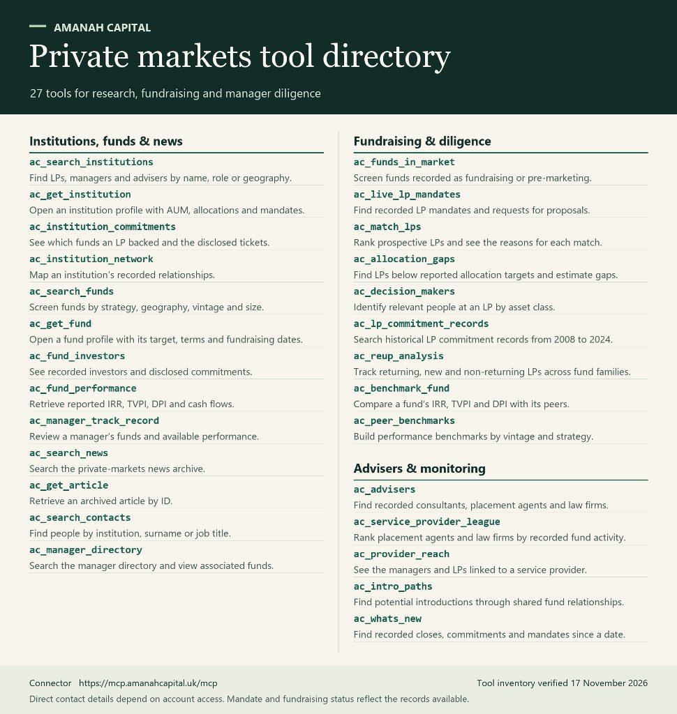

  

# Amanah Capital Private Markets MCP Connector

You can now connect Amanah Capital Private Markets to Claude or ChatGPT and ask questions across our private-markets dataset. The connector brings together 27 tools covering fundraising, allocator research, manager diligence, fund performance and adviser networks. You can ask in plain English and combine several steps in one request.

The dataset covers 28,304 institutions, including 11,716 LPs and 15,070 fund managers, alongside 44,895 funds. It includes 155,198 commitment records, 292,711 performance records covering 6,384 funds, and 322,262 recorded relationships. At the data cutoff, 7,432 funds were recorded as fundraising or pre-marketing and 63 LP mandates or requests for proposals were recorded as open.

  

## How to Connect

### 1. Claude Desktop App
Add the following to your claude_desktop_config.json:
`json
{
  "mcpServers": {
    "amanah-private-markets": {
      "command": "npx",
      "args": [
        "-y",
        "@modelcontextprotocol/server-sse",
        "https://mcp.amanahcapital.uk/mcp"
      ]
    }
  }
}
`
*Note: A sign-in portal will open on your first request to authorize the connection.*

### 2. Cursor / AI IDEs
1. Go to Cursor Settings -> Features -> MCP
2. Click **+ Add New MCP Server**
3. Select type: **SSE**
4. URL: https://mcp.amanahcapital.uk/mcp

### 3. OpenAI GPTs (Custom Actions)
You can create a custom GPT in the OpenAI interface.
1. Create a new GPT -> Configure -> Add Action
2. Import from URL: https://mcp.amanahcapital.uk/openapi.json (if exposed) or point the base URL to https://mcp.amanahcapital.uk/mcp using SSE action adapters.
3. Users will be prompted to authenticate via OAuth upon use.

## For Developers (API Access)
If you wish to query the MCP tools programmatically via script, provide your access key as a Bearer token:
Authorization: Bearer <your-access-key>

## Access & Billing
Access requires an API key. For enterprise limits, row caps, or contact-field access, contact Amanah Capital.

